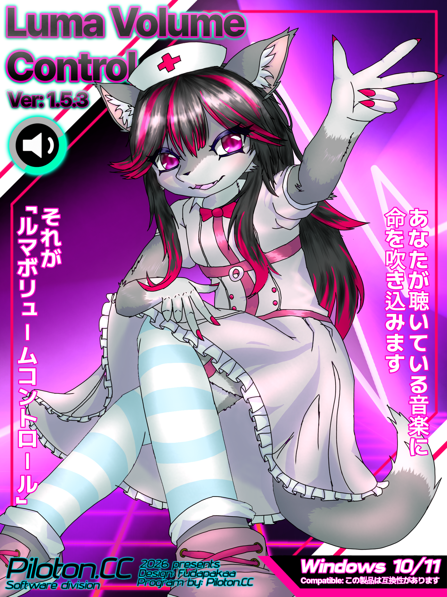

<p align="center">
  <a href="./assets/luma-volume-control-v1.5.3.png"></a>
</p>

# Luma Volume Control

Lumaシリーズと共通のダークUIを持つ、Windows用の常駐ボリュームミキサーです。

## ダウンロード

[v1.5.3のインストーラー（Windows x64）](https://github.com/Piloton1231/LumaVolumeControl/releases/download/v1.5.3/LumaVolumeControl-1.5.3-Setup.exe)

初期設定では、初めて検出したアプリの音量を30%に自動調整します。この機能は設定からオフにできます。

## 主な機能

- Windows 7風の縦型ミキサーで、音声を再生中のアプリを個別調整
- 縦バー内の滑らかな水色レベルメーターで、実際に音が出ているアプリを確認
- アプリの表示名・実行名・音量をプロファイルとして保存し、次回の音声セッション開始時に復元
- 初めて検出したアプリを指定音量へ自動調整（初期値30%）
- 自動適用、オーバーレイ、アニメーションを個別にON/OFF
- 対象アプリのモニターへ表示する音量変更オーバーレイ（中央・上下左右の7位置）
- バージョン表示位置を四隅から選択
- 保存済みアプリと割当音量の一覧・個別削除・一括リセット
- アプリごとのミュート、検索、実行ファイルからのアイコン取得
- アプリを名前順に固定し、音量レベルによる並び替わりを防止
- 大きな横スクロールボタンとマウスホイール横移動
- トレイ右クリックメニューからミキサー、設定、アプリ終了
- Windows自動起動、トレイ最小化、ホイール調整幅
- コンパクトモードでミキサーの列幅と間隔を縮小
- X-Yオシロスコープなどのオーディオビジュアライザー
- オシロスコープ感度25～200%（スペクトラム感度と個別に保存）

## 操作

- トレイアイコンを左クリック: ミキサーを表示／非表示
- トレイアイコンを右クリック: ミキサー・設定・終了メニュー
- 各アプリのスライダー: 音量変更と同時に「アプリ名 = 音量」を保存
- `Ctrl+M`: 標準表示とコンパクトモードを切り替え
- `Esc`: ミキサーを閉じる

設定は `%LOCALAPPDATA%\LumaVolumeControl\settings.json` に保存されます。

## ソースからビルド

Windows x64と.NET 9 SDKが必要です。PowerShellで次のコマンドを実行します。

```powershell
.\build.ps1
.\publish\LumaVolumeControl.exe
```
